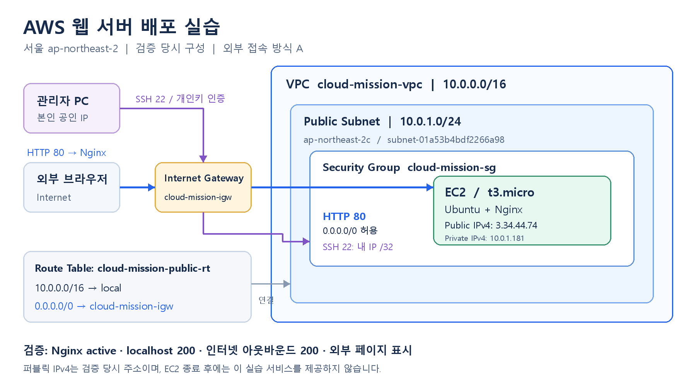

# AWS 웹 서버 배포 실습

서울 리전에 네트워크와 EC2를 구성하고, Nginx 외부 접속을 검증한 뒤 실습 리소스를 정리했다. 외부 검증은 **A 방식(브라우저 접속)**으로 수행했다.

## 1. 구성

| 항목 | 설정 |
|---|---|
| 리전 / 가용 영역 | `ap-northeast-2` / `ap-northeast-2c` |
| VPC | `cloud-mission-vpc`, `10.0.0.0/16` |
| Public Subnet | `subnet-01a53b4bdf2266a98`, `10.0.1.0/24` |
| Route Table | `cloud-mission-public-rt`, `rtb-0a3b0fb409be69615` |
| 인터넷 기본 경로 | `0.0.0.0/0 → igw-0c5813beab7d8332e` |
| EC2 | `i-0e9c852cc502e13e8`, `t3.micro`, Ubuntu |
| 웹 서버 | Nginx 1.24.0 |
| IAM | `cody_cloud`에 `CloudMissionPolicy` 연결 |
| Security Group | `cloud-mission-sg`: HTTP 80 전체 허용, SSH 22 본인 IP `/32` 허용 |



## 2. 수행 과정

1. **권한 준비:** 실습용 IAM 사용자에 EC2·VPC 관련 조회·생성·수정·삭제 작업을 허용하는 [정책](docs/iam-policy.json)을 연결했다. 요청 리전은 서울로 제한했다.
2. **리전 오류 해결:** 서울에서 `ec2:DescribeVpcs`가 SCP의 명시적 거부로 실패했다. 리전 제한 정책의 `RegionFloor`에서 서울 누락을 확인하고 예외 목록에 `ap-northeast-2`를 추가했다.
3. **네트워크 구성:** VPC·Subnet·IGW를 만들고 IGW를 VPC에 연결했다. Public Route Table에 기본 경로를 추가하고 Subnet을 연결했다. Subnet의 퍼블릭 IPv4 자동 할당을 활성화했다.
4. **EC2 생성:** 위 Subnet에 `t3.micro` 1대를 배치하고 SSH 키페어와 보안 그룹을 지정했다. 퍼블릭 IPv4는 `3.34.44.74`였다.
5. **SSH 오류 해결:** Windows 개인키의 `bad permissions` 오류를 확인하고, `icacls`로 현재 사용자만 읽도록 설정한 뒤 접속했다. [트러블슈팅 보고서](docs/troubleshooting.md)
6. **Nginx 설치·검증:** 아래 명령으로 설치하고 실행 상태, 내부 응답 및 인터넷 통신을 확인했다.

   ```bash
   sudo apt update
   sudo apt install -y nginx
   sudo systemctl enable --now nginx

   systemctl is-active nginx      # active
   curl -I http://localhost       # HTTP/1.1 200 OK
   curl -I https://example.com    # HTTP/2 200
   ```

7. **외부 접속:** PC 브라우저에서 `http://3.34.44.74`로 접속해 `Welcome to nginx!` 페이지를 확인했다. A 방식을 선택했으므로 `/health`는 구현하지 않았다.
8. **리소스 정리:** EC2 종료, EBS 잔존 없음, EIP 할당 없음, 실습 VPC 삭제를 캡처로 확인했다. IGW 개별 삭제 여부는 [정리 체크리스트](docs/cleanup-checklist.md)에 최종 확인 항목으로 남겼다.

접속 주소는 **검증 당시 주소**이며, 인스턴스 종료 후에는 이 실습 서비스를 제공하지 않는다.

## 3. 증빙

| 증빙 | 파일 |
|---|---|
| IAM 사용자와 정책 연결 | [IAM](docs/screenshots/01-iam.png), [정책 JSON](docs/iam-policy.json) |
| 기본 경로·네트워크 연결 | [라우팅](docs/screenshots/02-routing.png), [리소스 맵](docs/screenshots/03-resource-map.png) |
| Subnet CIDR·AZ·최종 Route Table 연결 | [Subnet](docs/screenshots/04-subnet.png) |
| EC2 실행·퍼블릭 IP | [EC2](docs/screenshots/05-ec2-running.png) |
| SSH 세션·Nginx active·내부 200 | [서버 내부 검증](docs/screenshots/06-service.png) |
| 인터넷 아웃바운드 | [외부 사이트 응답](docs/screenshots/07-outbound.png) |
| 브라우저 외부 접속 | [Nginx 페이지](docs/screenshots/08-external.png) |
| 인바운드 포트·소스 제한 | [보안 그룹](docs/screenshots/09-security-group.png) |
| SSH 개인키 오류 | [오류 화면](docs/screenshots/10-ssh-permissions-error.png) |
| 리소스 정리 | [EC2 종료](docs/screenshots/11-ec2-terminated.png), [EBS 없음](docs/screenshots/12-ebs-empty.png), [EIP 없음](docs/screenshots/13-eip-empty.png), [VPC 삭제](docs/screenshots/14-vpc-deleted.png) |

EC2 실행 캡처의 상태 검사는 생성 직후의 `초기화` 상태다. 이후 SSH·내부 200·외부 접속 성공은 별도 캡처로 확인했다. IAM 캡처는 사용자와 정책의 연결 상태를 보여주며, 모든 작업의 실행 주체를 증명하는 감사 로그는 포함하지 않는다.

## 4. 평가항목별 설명

### 항목 1. 필수 구현 및 검증

| 평가 문항 | 설명 |
|---|---|
| VPC·Public Subnet·IGW·기본 경로 구성 | `10.0.0.0/16` VPC 안에 `10.0.1.0/24` Subnet을 만들고, 연결한 테이블에 `0.0.0.0/0 → IGW`를 설정했다. |
| SSH 접속 및 웹 서버 실행 | SSH 세션에서 Nginx `active`와 `localhost`의 `200 OK`를 확인했다. |
| 필요한 인바운드 포트 및 SSH IP 제한 | HTTP 80은 `0.0.0.0/0`, SSH 22는 본인 공인 IP `/32`로 제한했다. 전체 포트 허용 규칙은 없다. |
| 외부 접속 A/B 검증 | A 선택. 브라우저 주소창의 퍼블릭 IP와 Nginx 페이지를 함께 캡처했다. |
| EC2·EBS·EIP·IGW·VPC 정리 | EC2 종료, EBS 없음, EIP 없음, VPC 삭제를 확인했다. IGW 개별 확인은 체크리스트에 남겼다. |

### 항목 2. 설계 및 수행 이유

| 평가 문항 | 설명 |
|---|---|
| 외부 → IGW → Subnet → EC2 흐름 | 외부 HTTP 요청은 퍼블릭 IPv4를 통해 IGW와 Subnet의 EC2에 도달한다. EC2 보안 그룹이 80번을 허용하고 Nginx가 응답한다. |
| 보안 그룹 최소화 기준 | 서비스용 80번과 관리용 22번만 허용했다. 사용하지 않는 HTTPS·DB 등의 포트는 추가하지 않았다. |
| A/B 선택 및 구현 | 추가 엔드포인트 개발 없이 검증할 수 있는 A를 선택했다. Nginx 기본 페이지를 80번으로 제공했다. |
| 리소스 추적·정리 기준 | `cloud-mission-` 이름 접두어와 리소스 ID로 식별했다. 이름이 없는 Subnet은 ID로 추적하고 체크리스트에 정리 상태를 기록했다. |

### 항목 3. 원리 및 보안 이해

| 평가 문항 | 설명 |
|---|---|
| 기본 경로가 필요한 이유 | 더 구체적인 경로가 없는 인터넷 목적지의 트래픽과 외부 요청에 대한 반환 트래픽을 IGW로 보낸다. EC2의 퍼블릭 IPv4와 통신 허용 설정도 필요하다. |
| Security Group과 IAM의 차이·최소권한 | SG는 네트워크 통신, IAM은 AWS API 작업 권한을 제어한다. 실습 정책은 작업과 리전을 제한해 불필요한 권한을 줄였다. 리소스 ID·태그 단위 제한까지 적용한 정책은 아니다. |
| SSH·DB 포트를 전체 공개하면 안 되는 이유 | 불특정 사용자의 접속 시도와 공격에 노출된다. 관리 포트는 본인 IP 또는 VPN으로, DB는 필요한 애플리케이션 보안 그룹 등으로 소스를 제한한다. |
| 가설 → 검증과 근거 활용 | SSH 오류에서 키 무시 메시지를 근거로 파일 권한을 의심하고, ACL 확인·수정 후 접속 성공으로 검증했다. 오류 문구·권한 출력·성공 화면을 근거로 사용했다. |

### 항목 4. 문제 대응 및 확장

| 평가 문항 | 설명 |
|---|---|
| 외부 접속 실패 점검 순서 | Subnet에 연결된 라우팅 테이블과 IGW → SG 인바운드 → 퍼블릭 IP·DNS → Nginx 상태·리스닝 포트·접근/오류 로그 순으로 확인한다. 내부 `curl`과 외부 요청을 비교한다. |
| IAM 부족 시 최소 범위 찾기 | 오류의 작업명·실행 주체·대상 리소스를 확인해 필요한 권한만 조정한다. SCP의 명시적 거부는 IAM 허용 추가로 해결되지 않으므로 상위 정책을 확인한다. |
| EC2를 2대로 늘릴 때 | 현재는 EC2 1대가 처리와 가용성을 모두 담당한다. CPU·메모리·요청량으로 병목을 확인하고 ALB와 EC2 2대, 서로 다른 AZ 구성을 검토한다. 이번 실습에서는 생성하지 않았다. |
| 예상 밖 Billing 비용 대응 | 서비스·리전별 사용 내역에서 EC2, 잔여 EBS, 퍼블릭 IPv4/EIP, 스냅샷 등을 확인한다. 생성했다면 NAT Gateway·ALB·RDS도 점검하고 실습 ID 기준으로 정리한다. |

### 항목 5. 보너스

HTTPS·Docker는 수행하지 않았다. HTTP와 Nginx 기본 페이지로 필수 기능을 검증했다.

## 5. 제출 문서

- [아키텍처 PNG](docs/architecture.png)
- [트러블슈팅 보고서](docs/troubleshooting.md)
- [리소스 정리 체크리스트](docs/cleanup-checklist.md)
- [IAM 정책 JSON](docs/iam-policy.json)

참고: [AWS 리전 제한 및 고급 기능](https://docs.aws.amazon.com/accounts/latest/reference/activate-advanced-features.html), [SSH 연결 오류 해결](https://docs.aws.amazon.com/AWSEC2/latest/UserGuide/TroubleshootingInstancesConnecting.html), [VPC 삭제](https://docs.aws.amazon.com/vpc/latest/userguide/delete-vpc.html).
